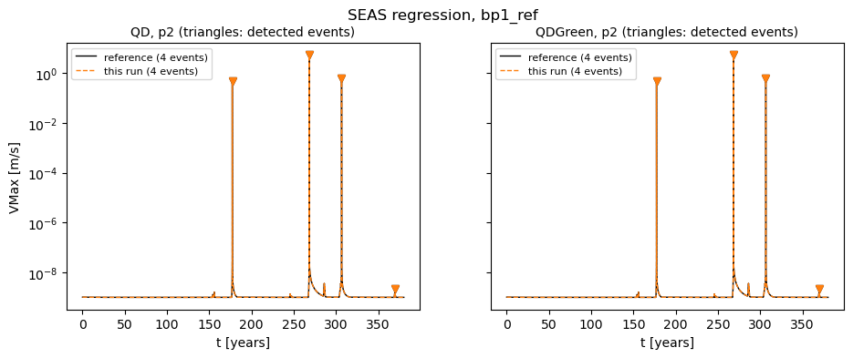
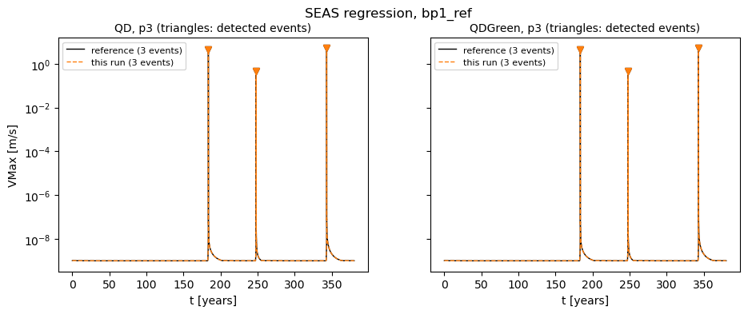

Integration tests
=================

Every integration test has two parts:

* a **generator script** in ``test/scripts/<dim>D/``, which runs the solver and writes
  logs and output files to ``test/temp_test_results/``, and
* a **pytest module** ``test/test_*.py``, which reads these files and checks them.

The tolerances and the measured values quoted below come from ``test/conftest.py``.
The exact solutions are derived in :doc:`analytical-solutions`.
The criteria of all tests are collected in one table in :doc:`results`.

Most generator scripts run the configuration from ``test/reference_configs/``.
The boundary condition and viscoelastic tests run the documented examples in ``examples/``
instead, so that the examples are what is verified. They copy the example into a work
directory under ``temp_test_results/`` and run it there, so nothing is written into ``examples/``.

Static regression
-----------------

:pytest: ``test_regression_static.py::test_static_solver_vtu_consistency``
:ctest: ``static-regression-test-<dim>D-p<deg>`` (degrees 2 and 3 only)
:generator: ``scripts/2D/static_regression.sh``, ``scripts/3D/static_regression.sh``
:ground truth: stored VTU, see :doc:`reference-data`

**Objective.** Detect any change in the static elasticity solution, compared with an earlier
version of tandem.

**Setup.**

* 2D: ``circular_hole`` (an infinite plate with a hole under far-field shear, see
  :ref:`as-circular-hole`). 3D: ``spherical_hole`` (see :ref:`as-spherical-hole`).
* The mesh is the stored mesh ``test_data/reference_meshes/<dim>D/<name>.msh``,
  not a new gmsh run, so that the result does not depend on the gmsh version.
* ``app/static`` with ``--matrix_free yes --mg_strategy twolevel --mg_coarse_level 1``
  and ``mg_cheby.cfg``: FGMRES (``rtol 1e-15``), Chebyshev/Jacobi smoother with 10 iterations,
  coarse solve with CG and GAMG.

**Check.** The test reads ``output<dim>D_0.vtu`` and
``test_data/reference_results/p<deg>/ref_regression_<dim>D_output.vtu`` with meshio and
compares the point field ``u0`` with ``numpy.testing.assert_allclose(out, ref, atol=1e-8)``.
``assert_allclose`` also has its default ``rtol=1e-7``, so each value must satisfy
``|out - ref| <= 1e-8 + 1e-7 |ref|``.
The comparison is by array index, so the stored mesh and the point order must be the same.

SEAS regression
---------------

:pytest: ``test_regression_SEAS.py``, 3 tests
:ctest: ``SEAS-regression-test-2D-p<deg>`` (2D, degrees 2 and 3 only)
:generator: ``scripts/2D/seas_regression.sh``
:ground truth: stored VMax time series, see :doc:`reference-data`

**Objective.** Detect changes in an earthquake-cycle simulation, in both the
volume-discretised (QD) and the Green's function (QDGreen) mode.

**Setup.**

* ``bp1_ref``: a 2D antiplane version of SCEC benchmark BP1 (``type = "poisson"``),
  rate-and-state friction with ``a`` increasing below 15 km,
  ``final_time = 1.2e10`` s (about 380 years).
* The mesh is the stored ``test_data/reference_meshes/2D/bp1_ref.msh``.
* ``solver.cfg``: LU (MUMPS) for the linear solve; time stepping with
  RK 5(4) Dormand-Prince, ``ts_rtol 1e-8``, ``ts_atol 1e-50``, infinity norm.
* Output: ``[fault_scalar_output]`` writes ``VMax(t)``, the maximum slip rate on the fault.
* The QDGreen run loads the Green's functions from
  ``test_data/reference_results/p<deg>/gf_ref/`` (``[gf_checkpoint]``).
  It therefore tests the loading of stored Green's functions and the QDGreen time stepping,
  not the computation of the Green's functions.

**Event detection** (``detect_events``). The time series is scanned with a window of
``window_size = 1e9`` s (about 32 years). If the maximum in the window is at least
``relative_error = 0.5`` (50 %) above the values at both window edges, the maximum is an event
and the scan continues after the window. If not, the window moves by one sample.

**Checks.** ``check_SEAS_consistency`` compares two event lists:

#. the number of events must be equal (exactly);
#. the event times must agree, ``np.allclose(rtol = seas[p<deg>])``;
#. the peak slip rates must agree, ``np.allclose(rtol = 1e-2)``;
#. the intervals between events must agree, ``np.allclose(rtol = seas[p<deg>])``.

``seas`` is ``1e-2`` for p2 and ``1e-8`` for p3. ``np.allclose`` also has its default
``atol = 1e-8``.

The three tests are:

``test_SEAS_consistency_QD``
   QD run against ``vmax_ref_QD.csv``.
``test_SEAS_consistency_QDGreen``
   QDGreen run against ``vmax_ref_QDGreen.csv``.
``test_SEAS_consistency_QD_vs_QDGreen``
   QD run against QDGreen run of the same build. The two modes must give the same events.

   2D p2: the stored reference (black) and this run (orange), with the events the detector finds
   (triangles). The fourth p2 "event" (369.8 years, ``2.1e-9`` m/s) is a small slow-slip bump,
   not an earthquake; the detector counts it because it is 50 % above the window edges.
   See :ref:`results-observations`.

   2D p3: three events.

Static convergence
------------------

:pytest: ``test_convergence_static.py::test_convergence``
:ctest: ``convergence-test-<dim>D-p<deg>`` (any degree)
:generator: ``scripts/2D/convergence.sh``, ``scripts/3D/convergence.sh``
:ground truth: exact solution, :ref:`as-circular-hole` and :ref:`as-spherical-hole`

**Objective.** Check that the DG discretisation converges at the expected rate.

**Setup.** ``circular_hole`` (2D) with the gmsh parameter ``h = 0.125, 0.0625, 0.03125, 0.015625``,
and ``spherical_hole`` (3D) with ``h = 0.5, 0.25, 0.125``. The fit uses the mesh size that ``app/static``
prints (``Mesh size:``), which differs from the gmsh parameter.
gmsh makes each mesh with ``-order 8`` (curved elements), so the geometry error
does not limit the rate. ``app/static`` with the default solver prints
``L2 error`` and ``H1-semi error`` against the exact solution.

**Check.** A least-squares fit of ``log(error)`` against ``log(h)`` gives the order.
For degree :math:`p`:

* L2 order in the open interval :math:`(p, p+1)`;
* H1-semi order in the open interval :math:`(p-1, p)`.

Parallel consistency (static)
-----------------------------

:pytest: ``test_parallel_consistency_static.py::test_parallel_consistency``
:ctest: ``parallel-consistency-test-<dim>D-p<deg>`` (any degree)
:generator: ``scripts/<dim>D/static_parallel_consistency.sh``
:ground truth: the single-process run

**Objective.** The domain decomposition must not change the solution.

**Setup.** ``circular_hole`` (2D) or ``spherical_hole`` (3D) on 1, 2, 4 and 8 MPI processes
(``mpirun --oversubscribe``), with the solver of the static regression test.

**Check.** For every point field in the VTU output, and for 2, 4 and 8 processes:

* the number of cells and points must equal that of the 1-process run;
* cells are matched by their centroid and points by their position, both within
  ``spatial_match = 1e-8``; every cell must find a match;
* the L2 norm of all point differences must be below ``static = 1e-8``.

Probe writer consistency (HDF5)
-------------------------------

:pytest: ``test_probe_writer_consistency.py``, 3 tests
:ctest: ``probe-writer-consistency-test-2D-p<deg>`` (2D, only with ``ENABLE_HDF5``)
:generator: ``scripts/2D/HDF5_probe_writer.sh``
:ground truth: the CSV writer, and one stored number

**Objective.** The HDF5 output writers must write the same data as the CSV writers,
and the moment rate output must be correct.

**Setup.** ``bp1_ref`` in QDGreen mode, ``final_time = 4e8`` s, run twice with the same probes:
once with ``type = "CSV"`` and once with ``type = "HDF5"`` plus ``[moment_rate_output]``.
The Green's functions are computed in this run (prefix ``temp_test_results/gf_bp1/``).

**Checks.**

``test_moment_rate``
   ``moment_rate.h5`` has the datasets ``time``, ``momentRate``, ``faultNo`` and ``faultVertices``,
   none empty, and ``momentRate`` has the shape ``(elements, time steps, 1)``.
   The sum over all fault elements at the first output time must be
   ``1.281524803579644e-06`` with ``rtol = 1e-8``.
``test_blkst_csv_and_h5_match``, ``test_fltst_csv_and_h5_match``
   For the domain probes (``blkst``) and the fault probes (``fltst``):
   the HDF5 file opens (a crash during a write leaves it unreadable), the datasets
   ``time``, ``probeData``, ``probeFields`` and ``probeNames`` exist with consistent shapes,
   and every field of every probe agrees with the CSV file (same row count,
   ``rtol = atol = 1e-8``). No HDF5 field may be all zero.

Volume tagging correctness
--------------------------

:pytest: ``test_correctness_volume_tagging.py::test_correctness_volume_tagging``
:ctest: ``volume-tagging-correctness-test-2D-p<deg>`` (2D, any degree)
:generator: ``scripts/2D/volume_tagging_correctness.sh``
:ground truth: exact solution, :ref:`as-volume-tagging`

**Objective.** Material parameters must follow the volume tag of the mesh.

**Setup.** Poisson problem on two regions with conductivity ``k = 1`` (tag 1) and ``k = 2``
(other tag), Dirichlet data on the left and right, natural boundary on top and bottom.

**Check.** The last ``L2 error`` in the log must be below ``static = 1e-8``.
The exact solution is piecewise linear with the kink on the tag interface, so
a mesh that follows the interface represents it exactly. A wrong tag lookup moves the kink.

Volume tagging parallel consistency
-----------------------------------

:pytest: ``test_parallel_consistency_volume_tagging.py``
:ctest: ``volume-tagging-parallel-consistency-test-2D-p<deg>`` (2D, any degree)
:generator: ``scripts/2D/volume_tagging_parallel_consistency.sh``
:ground truth: the single-process run

**Objective.** Volume tags must survive the mesh partitioning.

**Setup.** Elasticity with four volume tags (``mu = 1, 2, 3, 4``, ``lam = 2``), on 1, 2, 4
and 8 processes, default solver.

**Check.** The same check as the static parallel consistency test
(it calls the same function, ``_run_parallel_consistency``).

Free slip boundary condition
----------------------------

:pytest: ``test_free_slip_bc.py::test_free_slip_bc``, 4 cases
:ctest: ``free-slip-bc-test-<dim>D-p<deg>`` (2D and 3D, any degree)
:generator: ``scripts/<dim>D/free_slip_bc.sh``
:configuration: ``examples/elasticity/{2d,3d}/free_slip.{geo,lua,toml}``
:ground truth: exact solution, :ref:`as-free-slip`

**Objective.** Check the free slip condition (tag 9: prescribed normal displacement
:math:`\boldsymbol{u}\cdot\boldsymbol{n} = g`, no tangential traction) and a traction-free top.

**Setup.** The unit square (unit cube in 3D). Free slip with :math:`u_n = g` on the sides,
:math:`u_n = 0` on the bottom, traction free on top. ``mu = 1``, ``lam = 2``
(different, so that a mix-up of the Lame parameters shows in the error).
Two scenarios: ``free_slip_extension`` (:math:`g = 1`) and ``free_slip_compression``
(:math:`g = -1`). ``app/static``, default solver.

**Check.** Parametrised over the two scenarios and the two labels ``L2 error`` and
``H1-semi error``. The last value of the label in the log must be below ``static = 1e-8``.
An empty list usually means the solve did not converge (the log then contains
``Solver did not converge.``).
The exact solution is linear, so it must be matched to solver precision on any mesh and degree.

Traction and traction-free boundary conditions (2D)
---------------------------------------------------

:pytest: ``test_traction_patch_bc.py::test_traction_patch_bc``, 8 cases
:ctest: ``traction-patch-bc-test-2D-p<deg>`` (2D, any degree)
:generator: ``scripts/2D/traction_patch_bc.sh``
:configuration: ``examples/elasticity/2d/traction_patch.{geo,lua,toml}``
:ground truth: exact solution, :ref:`as-traction-patch`

**Objective.** Check a prescribed traction (tag 7) and the traction-free
(natural, tag 1) condition, and that a boundary traction does not depend on ``ref_normal``.

**Setup.** The unit square in uniaxial plane-strain tension or compression:
Dirichlet with the exact field on the left (tag 5), traction :math:`(s, 0)` on the right
(tag 7), traction free on top and bottom (tag 1). ``mu = 1``, ``lam = 2``.
Scenarios ``traction_patch_tension`` (:math:`s = 1`) and ``traction_patch_compression``
(:math:`s = -1`). Each is run with ``ref_normal = [1, 0]`` and again with ``[-1, 0]``
(the script makes the second ``.toml`` with sed).

**Check.** 2 scenarios x 2 normals x 2 labels. Each error must be below ``static = 1e-8``.
The top and bottom are the only traction-free facets in the suite where the exact
solution depends on the flux, so a wrong sign, a missing term or a spurious penalty on a
natural facet shows here. Tension and compression together stop a sign error from cancelling.

Traction boundary condition (3D rod)
------------------------------------

:pytest: ``test_traction_bc.py::test_traction_bc``
:ctest: ``traction-bc-test-3D`` (3D)
:generator: ``scripts/3D/traction_bc.sh``
:configuration: ``test/reference_configs/3D/cantilever_rod.{geo,lua,toml}``
:ground truth: closed-form end displacement, :ref:`as-rod`

**Objective.** Check the traction boundary condition in 3D.

**Setup.** A rod of length ``L = 1e-4`` km (100 mm) with a 30 mm x 30 mm section.
All displacements are zero at ``x = 0`` (tag 5), the end ``x = L`` carries the traction
``(0.01, 0, 0)`` GPa = 10 MPa (tag 7), the sides are traction free.
``mu = 77`` GPa, ``lam = 115`` GPa. ``mg_cheby.cfg`` solver.

**Check.** For all VTU points with :math:`|x - L| \le 10^{-8}`, the L2 norm of
``u0 - 5e-9`` must be below ``static = 1e-8``.
This is a coarse check, see :ref:`results-observations`.

Viscoelastic simple shear (2D)
------------------------------

:pytest: ``test_viscoelastic_simple_shear.py``, 3 tests x 6 cases
:ctest: ``viscoelastic-simple-shear-test-2D-p<deg>`` (2D, any degree)
:generator: ``scripts/2D/viscoelastic_simple_shear.sh``
:configuration: ``examples/tandem/viscoelasticity/2d/simple_shear.{geo,lua,toml}``
:ground truth: closed form, :ref:`as-simple-shear`

**Objective.** Check the time integration of the Maxwell branch of the standard linear solid,
and the stress at :math:`t = 0`.

**Setup.**

* The unit box under Dirichlet control on all four sides with :math:`u_x` linear in
  :math:`y`, so the stress is uniform and the 14-cell mesh is exact in space.
  Only the time integration and the :math:`t = 0` solve are measured.
* ``app/tandem`` in QD mode without a fault.
* :math:`\mu_0 = \mu_1 = 30` GPa, :math:`\eta = 2.36682\times10^{10}` GPa s,
  so :math:`\tau = \eta/\mu_1 = 7.8894\times10^{8}` s. The time step is capped at
  :math:`\theta\tau` with :math:`\theta = 0.05`.
* Six strain histories: constant strain, constant strain rate and sinusoid
  (:math:`\omega = 2/\tau`), each with and without a drop to zero after
  :math:`T_{hold} = 6\tau`.
* Direct solve (``examples/options/lu_mumps.cfg``). With a Krylov solver the error floor
  is the solver tolerance (``6.6e-6`` at ``ksp_rtol 1e-6``), not the time integration.
* The test reads the ``center`` probe, ``stress_xy``.

**Checks.**

``test_time_step``
   ``max_time_step`` in the summary equals :math:`\theta\tau` (``rel = 1e-12``),
   and there are no step rejections.
``test_initial_stress``
   :math:`\sigma_{xy}(0) = (\mu_0 + \mu_1)\,\gamma(0)`, the unrelaxed response, to
   ``1e-12`` relative to :math:`(\mu_0+\mu_1)\,2U_{max}/H`.
``test_stress_history``
   Relative MAE (:math:`\overline{|\sigma - \sigma_{ex}|} / \overline{|\sigma_{ex}|}`) and
   relative RMSE (:math:`\mathrm{rms}(\sigma - \sigma_{ex}) / \mathrm{rms}(\sigma_{ex})`).
   The two cases with a piecewise-linear strain history (constant strain, constant strain rate,
   without drop) must be below ``1e-10``: the exponential integrator is exact for them.
   The other four must be below ``1.25`` x the measured error (see :doc:`results`).

The errors are normalised globally, not pointwise, because the stress crosses zero.

Viscoelastic manufactured solution (2D)
---------------------------------------

:pytest: ``test_viscoelastic_mms.py``, 2 tests
:ctest: ``viscoelastic-mms-test-2D-p<deg>`` (2D, any degree)
:generator: ``scripts/2D/viscoelastic_mms.sh``
:configuration: ``examples/tandem/viscoelasticity/2d/mms.{lua,toml}``
:ground truth: manufactured solution, :ref:`as-mms`

**Objective.** Check the spatial and the temporal convergence order of the viscoelastic operator,
with a body force and a time-dependent solution.

**Setup.**

* The unit square, Dirichlet with the exact field on all sides, generated mesh
  (``[generate_mesh]``, ``--resolution``). ``app/tandem`` in QD mode, direct solve.
* :math:`\mu_0 = 2`, :math:`\mu_1 = 1.5`, :math:`\tau = 0.5`, ``final_time = 1``.
* Both fields are divergence free, so only the deviatoric memory path is tested,
  and both start from rest (the code needs this, see :ref:`as-mms`).
* Spatial study: scenario ``mms`` (trigonometric field), :math:`\theta = 0.01`,
  resolutions ``0.25, 0.125, 0.0625``.
* Temporal study: scenario ``mms_poly`` (polynomial field), resolution ``0.25``,
  :math:`\theta = 0.4, 0.2, 0.1, 0.05` (the script changes ``MMS.theta`` in a copy of ``mms.lua``).

**Checks.** Each run must have a constant step :math:`\theta\tau` and
``time_steps = final_time / dt``.

``test_spatial_convergence``
   Fit of ``log L2_error_domain`` against ``log h``: order :math:`p + 1 \pm 0.25`.
   The coarsest level ``0.5`` is left out because it is not yet in the asymptotic range.
``test_temporal_convergence``
   Fit against ``log theta``: order :math:`2 \pm 0.1`, and every local order (between
   neighbouring levels) also :math:`2 \pm 0.1`. If the finest :math:`\theta` reaches an error
   floor, the last local order fails instead of the fit becoming slightly low.
   Skipped for :math:`p < 2`, because the polynomial field needs :math:`p \ge 2`.

Viscoelastic rod creep and recovery (3D)
----------------------------------------

:pytest: ``test_viscoelastic_cantilever.py``, 5 tests (7 cases)
:ctest: ``viscoelastic-cantilever-test-3D-p<deg>`` (3D, any degree)
:generator: ``scripts/3D/viscoelastic_cantilever.sh``
:configuration: ``examples/tandem/viscoelasticity/3d/cantilever_rod.{geo,lua,toml}``
:ground truth: Zener closed form, :ref:`as-zener`

**Objective.** Check the viscoelastic operator under traction control in 3D: the unrelaxed
:math:`t = 0` solve, creep, the unloading step, recovery and the stress output.

**Setup.**

* The rod of the example, but meshed with ``-setnumber clamped 0``: the planes
  ``x = 0``, ``y = 0`` and ``z = 0`` are then symmetry planes (free slip with
  :math:`u_n = 0`, tag 9) instead of a clamp. The rod is in exactly uniaxial stress, the
  displacement is affine and lies in the discrete space (42 cells). Only the time
  integration is measured. (A clamp blocks the lateral contraction, and the closed form
  then holds only away from it.)
* :math:`G_0 = \mu_0 + \mu_1 = 0.337086` GPa, :math:`r_1 = \mu_1/G_0 = 0.901`,
  :math:`K = 10` GPa, :math:`\tau = 100` s, :math:`\theta = 0.1` (step 10 s).
* Traction :math:`s_0 = 0.01` GPa on ``x = L`` for :math:`t \le t_1 = 6000` s, then zero,
  until ``final_time = 10000`` s. Direct solve.
* Three probes along the rod: ``free_end``, ``mid``, ``near_fixed_end``.

**Strain measurement.** :math:`u_x = \varepsilon_{xx} x` exactly. At :math:`t = 0` the test uses
:math:`\varepsilon_{xx} = u_x / x`, with :math:`x` from the probe header (6 significant digits).
For the history it uses :math:`u_x(t)/u_x(0)\cdot s_0/E_0`, which does not depend on the probe position.

**Checks.**

``test_time_step``
   ``min_time_step = max_time_step = theta tau`` (``rel = 1e-12``) and
   ``time_steps = final_time / (theta tau)``.
``test_initial_strain`` (3 probes)
   :math:`\varepsilon_{xx}(0) = s_0/E_0` to ``1e-4`` relative. A :math:`t = 0` solve with the
   step-sized instead of the unrelaxed moduli is ``4.5 %`` off.
``test_creep``
   :math:`\max |\varepsilon_{xx} - \varepsilon_{ex}|` for :math:`t \le t_1` below
   ``1.25 x 2.4605e-6``. The strain must also reach ``0.99`` of :math:`s_0/E_\infty`.
``test_rebound``
   The first sample after :math:`t_1` overshoots by the predicted
   :math:`s_0 (1/E_{eff} - 1/E_0) = 4.5064\times10^{-4}`. The error must be below ``1.25`` x the prediction.
   This is a known first-order error of the scheme at a load jump. The test stops it from growing.
``test_recovery``
   RMS of :math:`\varepsilon_{xx} - \varepsilon_{ex}` for :math:`t > t_1` below ``1.25 x 1.5957e-4``.
``test_stress_output``
   While loaded, at all three probes: :math:`|\sigma_{xx}/s_0 - 1| < 10^{-8}` and every other
   stress component :math:`/s_0 < 10^{-8}`. This checks the stress output path, which the solve
   does not use.
