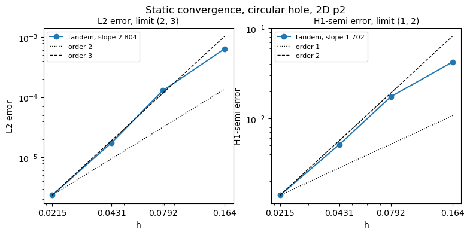
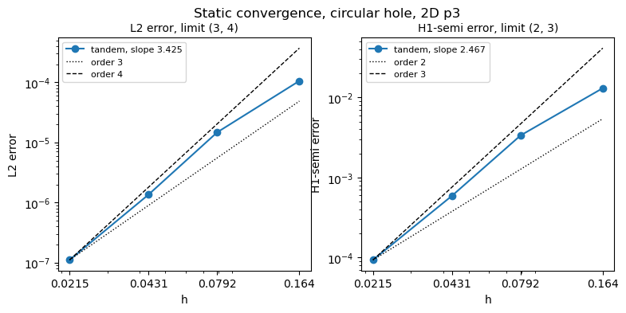
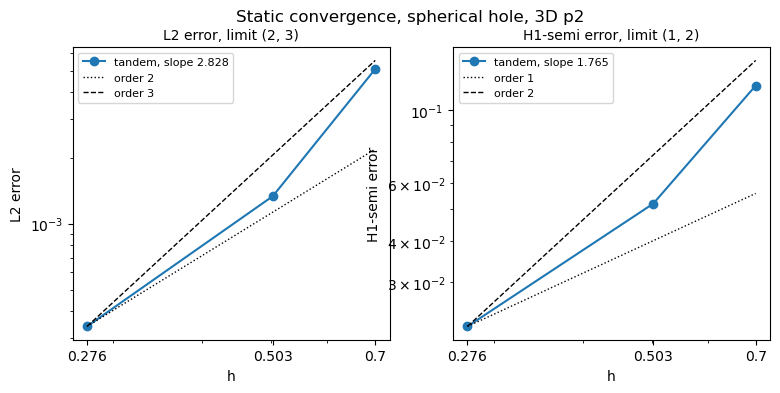
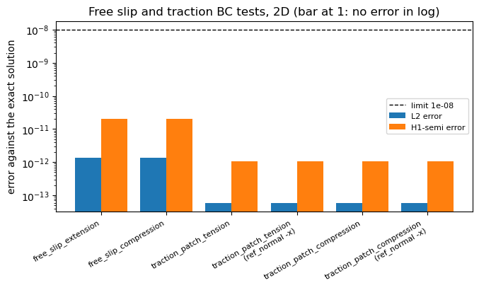
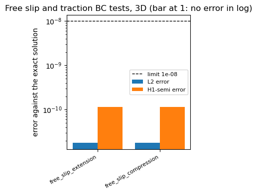
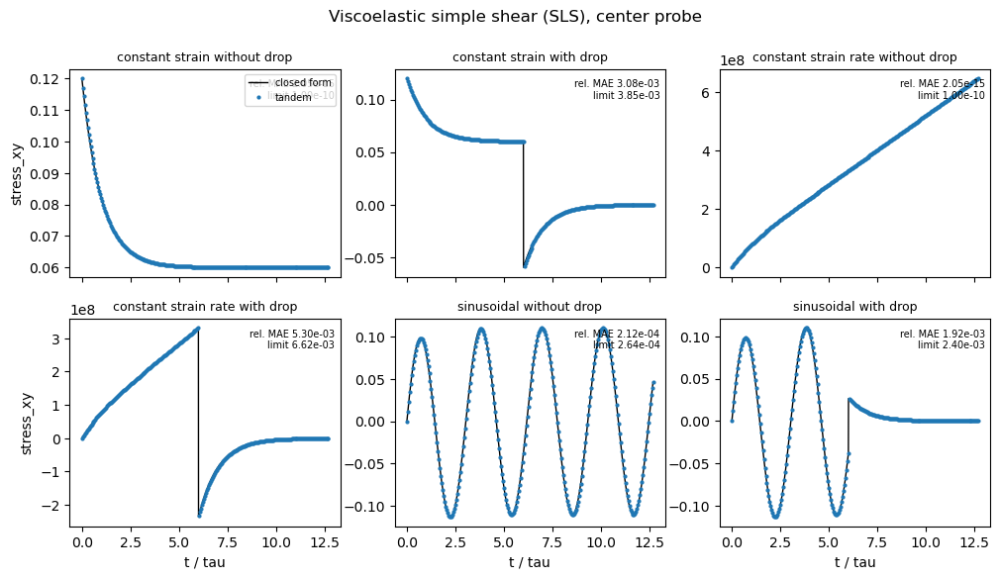
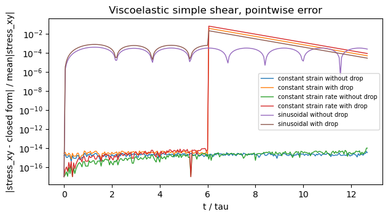
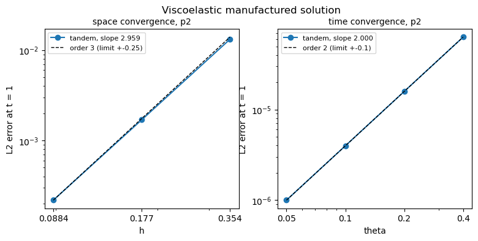
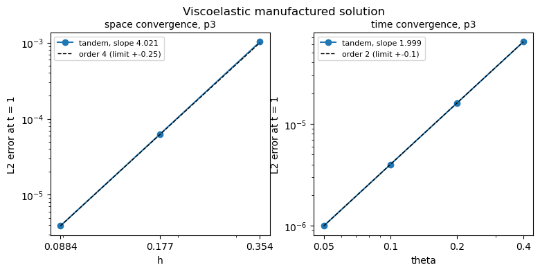
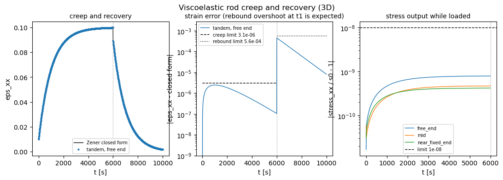

Results and benchmarks
======================

This page collects the pass criteria of every integration test, the values measured on the
current code, the run times, and the result plots. The limits are defined in
``test/conftest.py`` (fixtures ``tolerances`` and ``*_config``); if this page and the code disagree,
the code is right.

Measured values below are from 2026-10-24, branch with the viscoelastic tests, builds
2D p2, 2D p3 and 3D p2 on one workstation, unless a row says otherwise. All tests passed
(50/50, 50/50 and 46/46 ctest entries).

Pass criteria
-------------

.. list-table::
   :header-rows: 1
   :widths: 24 46 30

   * - test
     - criterion
     - limit
   * - static regression
     - ``u0`` at every point against the stored VTU
     - ``|out - ref| <= 1e-8 + 1e-7 |ref|``
   * - SEAS regression (x3)
     - number of events
     - equal
   * -
     - event times and intervals between events
     - ``rtol`` 1e-2 (p2), 1e-8 (p3)
   * -
     - peak slip rate of each event
     - ``rtol`` 1e-2
   * - static convergence
     - fitted L2 order
     - in :math:`(p, p+1)`
   * -
     - fitted H1-semi order
     - in :math:`(p-1, p)`
   * - parallel consistency (static and volume tagging)
     - cell and point counts, 2/4/8 against 1 process
     - equal
   * -
     - L2 norm of the point differences, every field
     - < 1e-8 (matching within 1e-8)
   * - probe writer
     - moment rate sum at the first output
     - ``1.281524803579644e-06``, ``rtol`` 1e-8
   * -
     - every CSV field against HDF5
     - ``rtol = atol = 1e-8``
   * - volume tagging correctness
     - L2 error
     - < 1e-8
   * - free slip BC (2D, 3D)
     - L2 and H1-semi error, extension and compression
     - < 1e-8
   * - traction patch BC (2D)
     - L2 and H1-semi error, tension/compression x two ``ref_normal``
     - < 1e-8
   * - traction BC (3D rod)
     - L2 norm of ``u0 - 5e-9`` on the end face
     - < 1e-8
   * - VE simple shear
     - time step equals :math:`\theta\tau`
     - ``rel`` 1e-12, no rejections
   * -
     - :math:`\sigma_{xy}(0) = (\mu_0+\mu_1)\gamma(0)`
     - 1e-12 relative
   * -
     - rel. MAE and RMSE, piecewise-linear histories
     - < 1e-10
   * -
     - rel. MAE and RMSE, other histories
     - < 1.25 x measured (table below)
   * - VE manufactured solution
     - spatial L2 order (3 levels)
     - :math:`p + 1 \pm 0.25`
   * -
     - temporal L2 order, fit and every local order (4 levels, :math:`p \ge 2`)
     - :math:`2 \pm 0.1`
   * - VE rod
     - time step and number of steps
     - ``rel`` 1e-12
   * -
     - :math:`\varepsilon_{xx}(0) = s_0/E_0`, 3 probes
     - 1e-4 relative
   * -
     - creep, max abs error
     - < 1.25 x 2.4605e-6
   * -
     - rebound error at the first sample after :math:`t_1`
     - < 1.25 x 4.5064e-4 (predicted)
   * -
     - recovery, RMS error
     - < 1.25 x 1.5957e-4
   * -
     - :math:`\sigma_{xx}/s_0 - 1` and other components :math:`/s_0`
     - < 1e-8

"1.25 x measured" means: the test passes today and fails if the error grows by 25 %.
The measured values are the error of the time scheme, not a bug; the limit stops them from getting worse.

Measured values
---------------

Static convergence
^^^^^^^^^^^^^^^^^^

.. list-table::
   :header-rows: 1

   * - build
     - L2 slope (limit)
     - H1-semi slope (limit)
   * - 2D p2
     - 2.804 (2, 3)
     - 1.702 (1, 2)
   * - 2D p3
     - 3.425 (3, 4)
     - 2.467 (2, 3)
   * - 3D p2
     - 2.828 (2, 3)
     - 1.765 (1, 2)

The fitted slopes lie inside the bands but below the optimal :math:`p + 1` and :math:`p`, because the coarse
meshes are not yet in the asymptotic range (the local orders between the two finest meshes are somewhat closer: about 2.9 at p2 and 3.6 at p3 in 2D).
See :ref:`results-observations`.

   2D p2. The ``h`` axis is the mesh size that ``app/static`` reports, not the gmsh parameter ``h``.

   2D p3.

   3D p2 (three meshes).

Static boundary condition tests
^^^^^^^^^^^^^^^^^^^^^^^^^^^^^^^

The exact solutions are linear, so the errors are at round-off, more than three orders of magnitude
below the limit.

   2D p2: free slip L2 about 1.4e-12, H1-semi about 2e-11; traction patch L2 about 6e-14,
   H1-semi about 1e-12. Both ``ref_normal`` give the same errors.

   3D p2: free slip.

Viscoelastic simple shear
^^^^^^^^^^^^^^^^^^^^^^^^^

Measured on 2026-10-20 (2D p2, one process, direct solve). They agree with an earlier
time step convergence study at :math:`\theta = 0.05` to 3-4 digits.
The cases with a drop are first order (the drop is a strain jump), the sinusoid is second order.

.. list-table::
   :header-rows: 1

   * - case
     - rel. MAE
     - rel. RMSE
     - limit (1.25 x)
   * - constant strain, without drop
     - 1.5e-15
     - 1.4e-15
     - 1e-10
   * - constant strain, with drop
     - 3.0779e-3
     - 5.8125e-3
     - 3.85e-3 / 7.27e-3
   * - constant strain rate, without drop
     - 2.05e-15 (2026-10-23)
     - not recorded
     - 1e-10
   * - constant strain rate, with drop
     - 5.2963e-3
     - 9.4575e-3
     - 6.62e-3 / 1.18e-2
   * - sinusoid, without drop
     - 2.1127e-4
     - 2.1221e-4
     - 2.64e-4 / 2.65e-4
   * - sinusoid, with drop
     - 1.9180e-3
     - 2.8734e-3
     - 2.40e-3 / 3.59e-3

:math:`\sigma_{xy}(0)` is measured at 8.9e-16 relative.

   ``stress_xy`` at the center probe (dots) against the closed form (line), 2D p2.

   The error of each case over time, 2D p2.

Viscoelastic manufactured solution
^^^^^^^^^^^^^^^^^^^^^^^^^^^^^^^^^^

.. list-table::
   :header-rows: 1

   * - study
     - degree
     - L2 errors
     - order
   * - space (resolution 0.25, 0.125, 0.0625)
     - p2
     - 1.33013e-2, 1.70094e-3, 2.19658e-4
     - 2.96 (expected 3)
   * -
     - p3
     -
     - 4.02 (expected 4)
   * - time (:math:`\theta` = 0.4, 0.2, 0.1, 0.05)
     - p2
     - 6.17024e-5, 1.53701e-5, 3.83429e-6, 9.57459e-7
     - 2.000 (local 2.005, 2.003, 2.002)
   * -
     - p3
     - same to 0.4 %
     - 2.00

   2D p2. The ``h`` axis is the mesh size the log reports.

   2D p3.

Viscoelastic rod
^^^^^^^^^^^^^^^^

.. list-table::
   :header-rows: 1

   * - quantity
     - measured
   * - :math:`\varepsilon_{xx}(0)` relative error
     - 2.9e-11 at the probe whose position prints exactly, <= 4e-7 at the others
   * - creep, max abs error
     - 2.4605e-6 (at :math:`t \approx \tau_c`)
   * - rebound error
     - -4.507446e-4 = 1.00023 x the predicted 4.5064e-4
   * - recovery, RMS error
     - 1.5957e-4
   * - stress output, :math:`|\sigma_{xx}/s_0 - 1|`
     - < 1e-9

   3D p2. Left: strain at the free end against the Zener closed form. Middle: the error with the
   limits; the jump at :math:`t_1` is the predicted rebound overshoot. Right: the stress output.

SEAS regression
^^^^^^^^^^^^^^^

Events in the stored references. The runs of the current code find the same events
(the plots show both).

.. list-table::
   :header-rows: 1

   * - reference
     - events (time in years, peak VMax in m/s)
   * - p2, QD
     - 177.2 (0.483), 268.2 (5.32), 306.6 (0.632), 369.8 (2.09e-9)
   * - p2, QDGreen
     - 177.2 (0.483), 268.2 (5.32), 306.6 (0.628), 369.8 (2.09e-9)
   * - p3, QD
     - 183.5 (4.38), 247.9 (0.465), 343.1 (5.13)
   * - p3, QDGreen
     - 183.5 (4.38), 247.9 (0.468), 343.1 (5.13)

.. figure:: images/seas_regression_vmax_2D_p2.png
   :width: 100%

   2D p2: stored reference (black) and this run (orange), QD and QDGreen.

.. figure:: images/seas_regression_vmax_2D_p3.png
   :width: 100%

   2D p3.

Run times
---------

ctest times for one build on a workstation (2026-10-24). The generator step runs every simulation;
the pytest tests only read files.

.. list-table::
   :header-rows: 1

   * - step
     - 2D p2
     - 2D p3
     - 3D p2
   * - ``generate-test-outputs``
     - 325 s
     - 885 s
     - 328 s
   * - ``parallel-consistency-test``
     - 3.3 s
     - 4.4 s
     - 10.4 s
   * - ``volume-tagging-parallel-consistency-test``
     - 4.0 s
     - 5.4 s
     -
   * - ``plot-test-results``
     - 5.3 s
     - 5.5 s
     - 4.4 s
   * - every other pytest test
     - 0.7-1.1 s
     - 0.7-1.2 s
     - 0.7-1.1 s

Result plots in CI
------------------

Every plot on these pages is made by ``test/plot_test_results.py``, in CI and locally.

When it runs
   ``plot_test_results.py`` is the ctest entry ``plot-test-results``. It exists when the build has
   ``-DRUN_CI_TESTS=ON`` and ``-DPLOT_CI_TESTS=ON`` (the default), so every CI job runs it, and so does
   ``ctest`` in any local build with integration tests. ``-DPLOT_CI_TESTS=OFF`` removes it.
   It requires the ``TestData`` fixture: ctest runs it after ``generate-test-outputs`` and before
   ``cleanup-test-outputs``.

What it reads
   Only the logs and output files that the tests read. It runs no simulation and adds a few seconds.

When it does not plot
   It never fails the build. A plot whose input is missing (the test does not exist in this build) or that
   raises an error is *skipped* with the reason, which ctest shows in its log (``-rs``).
   It still plots when a test fails, so the plots show the failure.
   If ``generate-test-outputs`` fails, ctest does not run it, because the fixture setup failed;
   there is then nothing to plot.

Where the files go
   ``<build>/Testing/Temporary/plots/<name>_<dim>D_p<deg>.png``, at 100 dpi (about 25-90 kB each).
   CI uploads them with the test logs as the artifact ``logs-<dim>d-p<deg>-hdf5-<ON|OFF>-<compiler>``.

The plots, per build:

.. list-table::
   :header-rows: 1
   :widths: 30 10 10 50

   * - file name
     - 2D
     - 3D
     - content
   * - ``static_convergence``
     - yes
     - yes
     - L2 and H1-semi error against h (log-log), the fitted slope, and the band it must lie in
   * - ``seas_regression_vmax``
     - p2, p3
     -
     - VMax of the QD and QDGreen runs over the stored reference, with the detected events
       (skipped for degrees without reference data)
   * - ``static_bc_errors``
     - yes
     - yes
     - free slip (2D, 3D) and traction patch (2D) errors against the limit
   * - ``viscoelastic_simple_shear_stress``
     - yes
     -
     - ``stress_xy`` against the closed form for the six loadings
   * - ``viscoelastic_simple_shear_error``
     - yes
     -
     - the error of each loading over time
   * - ``viscoelastic_mms_convergence``
     - yes
     -
     - spatial and (for :math:`p \ge 2`) temporal convergence of the manufactured solution
   * - ``viscoelastic_cantilever``
     -
     - yes
     - rod strain against the Zener solution, the strain error with its limits, the stress output

So a 2D build makes 6 plots (5 for a degree without SEAS reference data), a 3D build makes 3.

Updating the images in these docs
   Run ``ctest`` in a 2D p2, 2D p3 and 3D p2 build (or download the CI artifacts) and copy the PNGs
   from ``Testing/Temporary/plots/`` to ``docs/testing/images/``. The file names are the same.

.. _results-observations:

Observations and known weak points
----------------------------------

These do not make a test fail today, but you should know them when you read a result.

SEAS event count at p2
   The fourth p2 event (369.8 years, 2.09e-9 m/s) is a slow-slip bump near the plate rate,
   not an earthquake. The event count must match exactly, so a small change of this bump can fail the
   test. Its peak is also below the default ``atol = 1e-8`` of ``np.allclose``, so the magnitude check of
   this event always passes.

Static convergence band
   The fitted order only has to lie in :math:`(p, p+1)` for L2 (:math:`(p-1, p)` for H1-semi). The measured
   slopes (2.80 at p2, 3.43 at p3) are inside but below the optimal order, because the coarsest meshes are
   pre-asymptotic. A loss of a full order fails; a loss of half an order may not.

SEAS tolerance at p2
   Event times are compared to 1 % at p2 and to 1e-8 at p3. The p2 references and test runs agree less
   closely.

Static regression
   ``assert_allclose`` adds its default ``rtol = 1e-7`` to the stated ``atol = 1e-8``.
   The comparison is by array index, not by position.

Traction BC (3D rod)
   The limit 1e-8 is absolute and larger than the expected value 5e-9, and it applies to the L2 norm over
   all points on the end face. The test detects a missing or badly wrong traction, not a small error.
   The clamp at ``x = 0`` also makes :math:`\sigma_0 L/E` only approximate. The viscoelastic rod test
   checks the traction condition more strictly (symmetry planes, exact affine solution).

Probe writer moment rate
   The expected sum was computed at degree 2. The test also passes at degree 3, because at the first output
   the slip rate is uniform (``Vinit``), so the sum does not depend on the degree.

Viscoelastic rebound
   The unloading overshoot (4.5e-4 in strain) is a property of the time scheme. The test expects it.
